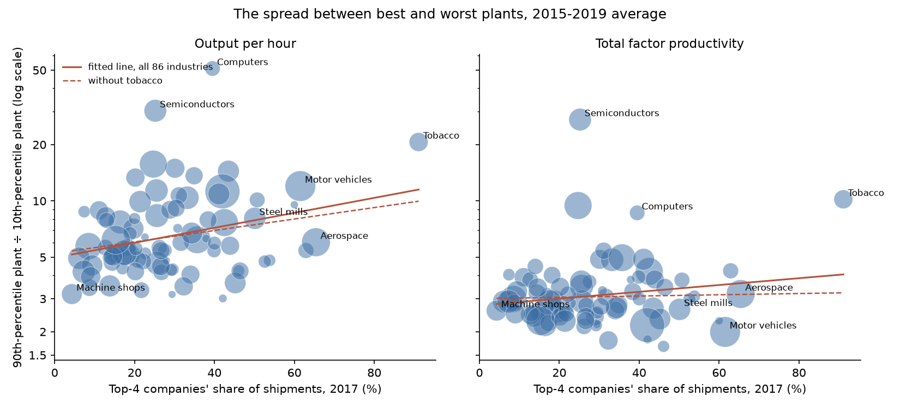
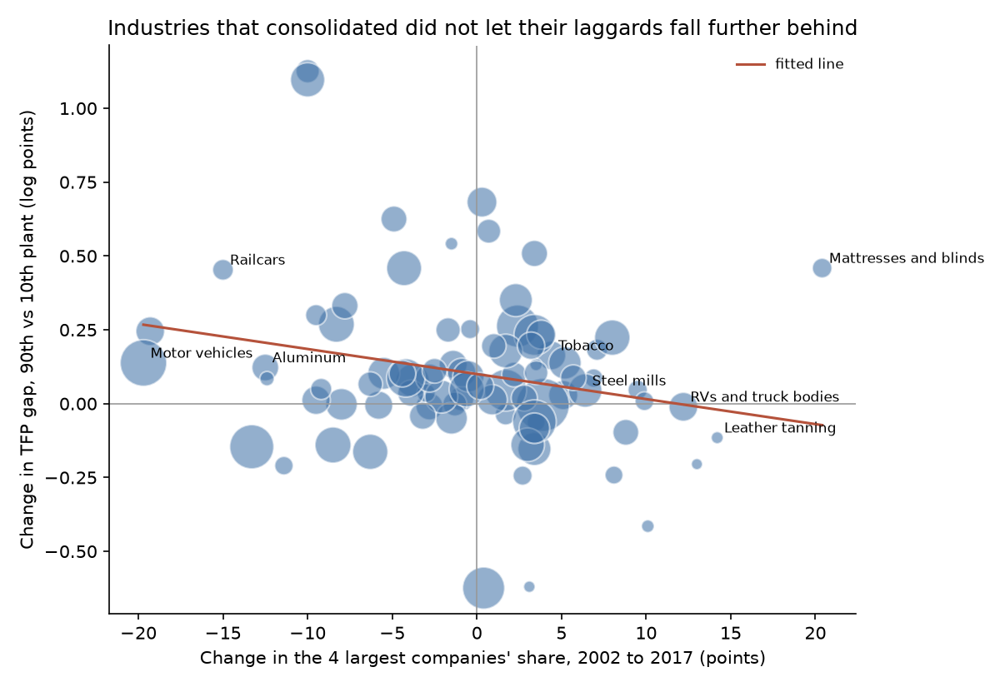

# The Best and Worst Factories in America

### In 1935, John Hicks suggested that companies with no one to fear stop trying so hard. Ninety years later, I looked inside American manufacturing to see whether he was right.

---

A pickup truck built in the United States came out of one of the 313 motor-vehicle plants counted in the 2017
Economic Census. The industry's four largest companies, drawn from General Motors, Ford, Fiat Chrysler, Toyota and
Honda, made 61.5% of everything it shipped. Inside that industry the gap between plants is enormous.
A plant at the 90th percentile turns out twelve times as much per hour of work as a plant at the 10th. Machine shops,
the small firms that cut bolts, shafts and fittings to order, look nothing like that. There were 22,804 of them, the
four biggest made 4.3% of the industry's sales, and the 90th-percentile shop produces only about three times as much
per hour as the 10th.

The obvious reading is that the auto industry, with few serious rivals, can afford to carry its laggards and the
machine shops cannot. John Hicks put that idea into one sentence in 1935, and economists who think monopoly costs
more than high prices have quoted it ever since.

---

## Two measures

The measure of competition is the one the Census publishes for every industry. Write $`s_{ij}`$ for the sales of
company $`j`$ in industry $`i`$, ranked from largest to smallest, and $`S_i`$ for the industry's total sales:

```math
\text{CR4}_i = \frac{s_{i1} + s_{i2} + s_{i3} + s_{i4}}{S_i}
```

Iron and steel mills are a good example. In 2022 the four largest steelmakers shipped $77.3 billion of the industry's
$129.8 billion:

```math
\text{CR4}_{\text{steel}} = \frac{77.3}{129.8} = 59.5\%
```

To measure slack I use the gap between an industry's good and bad plants, the test Chad Syverson made standard
in 2004. Census and the Bureau of Labor Statistics now publish it for every manufacturing industry, every year. Rank the
industry's plants by productivity $`\pi`$ and take the plants at the 90th and 10th percentiles. The published
statistic is the gap in logs, $`D_i`$, and the spread is its exponential, the ratio of the two plants' productivity:

```math
D_i = \ln \pi_{i,90} - \ln \pi_{i,10}, \qquad \text{Spread}_i = \frac{\pi_{i,90}}{\pi_{i,10}} = e^{D_i}
```

For steel mills in 2015 to 2019 the log gap in output per hour averaged 2.089, so

```math
\text{Spread}_{\text{steel}} = e^{2.089} = 8.1
```

and a strong mill produced about eight times as much per hour of work as a weak one. Output per hour flatters plants
that have more machinery, so the same tables also report total factor productivity, or TFP, which compares output
with all inputs together, meaning labor, equipment, materials and energy. Steel's TFP spread was 2.6.

| Output-per-hour spread, 2015–19 | Industry | Spread |
|---|---|---|
| Lowest | Footwear | 3.0 |
| Middle | Sawmills | 5.6 |
| Highest | Computers and peripherals | 51.0 |

---

## John Hicks's sentence

John Richard Hicks was born in Warwick, England, in 1904. He taught at the London School of Economics from 1926 to
1935, moved to Cambridge in 1935, then to Manchester and finally Oxford. He was knighted in 1964, and in 1972 he
shared the Nobel Memorial Prize in Economic Sciences with Kenneth Arrow for work on general equilibrium and welfare
theory. Most economics students meet him through the IS-LM diagram, his 1937 summary of Keynes.

In January 1935, aged thirty, he published a 20-page survey in the third volume of *Econometrica*, titled "Annual
Survey of Economic Theory: The Theory of Monopoly." It reviewed a burst of new books by Frederik Zeuthen, Erich
Schneider, Edward Chamberlin and Joan Robinson. Most of it is technical, covering marginal revenue, duopoly and
bilateral monopoly. On page 8, in a section about the owner's own effort, Hicks observed that profit varies little
for some distance on either side of its peak, that people in monopoly positions may well find extra effort
increasingly unpleasant, and that they would therefore exploit their position by not bothering to get close to
maximum profit. He ended the paragraph with the line economists still quote. "The best of all monopoly profits is a
quiet life."

The fact Hicks leaned on, that profit is flat near its peak, can be made exact. Suppose the monopolist faces a
straight-line demand curve, price $`p = a - bx`$ for output $`x`$, and makes each unit at a constant cost $`c`$.
Write $`x^*`$ for the most profitable output, $`\Pi^*`$ for the profit there, and let the firm produce a fraction
$`d`$ more or less than $`x^*`$:

```math
\begin{aligned}
\Pi(x) &= (a - bx)\,x - c\,x \\
\Pi'(x^*) = 0 \;&\Rightarrow\; x^* = \frac{a-c}{2b}, \qquad \Pi^* = b\,(x^*)^2 \\
\Pi\big((1+d)\,x^*\big) &= (a-c)(1+d)\,x^* - b\,(1+d)^2 (x^*)^2 \\
&= b\,(x^*)^2\,\big[\,2(1+d) - (1+d)^2\,\big] = \Pi^*\,(1 - d^2)
\end{aligned}
```

A firm that misses its best output by a fraction $`d`$ gives up only $`d^2`$ of its maximum profit. With any smooth
demand and cost curves the same holds near the top, with the loss scaled by how sharply marginal revenue and marginal
cost diverge, which is the comparison Hicks described in words. Steel mills had $38.7 billion left in 2022 after
paying for materials, wages and benefits. Treating that as the industry's maximum profit, running 10% away from the
best output would cost

```math
0.10^2 \times \$38.7\ \text{billion} = 1\% \times \$38.7\ \text{billion} \approx \$387\ \text{million}
```

across the industry, before counting any effort saved by not fine-tuning.

| Output misses the best level by | Share of maximum profit lost |
|---|---|
| 5% | 0.25% |
| 10% | 1% |
| 20% | 4% |
| 30% | 9% |

Because the loss grows with the square, small lapses are cheap and only large ones hurt. A firm sheltered from
competition can afford them. A firm in a crowded market cannot, because a rival who does not lapse will take its
customers.

Hicks gave no data and no estimate. He was skeptical in the same article that anyone could measure how much market
power a firm had from outside, since the answer lay in the monopolist's own estimates. The idea passed to Harvey
Leibenstein, who in 1966 called it "X-inefficiency" and argued in the *American Economic Review* that firms without
competitive pressure waste far more through slack than through high prices. George Stigler made the strongest
objection, in a 1976 note titled "The Xistence of X-Efficiency." In his view a firm that seems to leave money on the
table is maximizing something else or working with limited knowledge, and labeling that as waste explains nothing.

The modern evidence is more direct. Marianne Bertrand and Sendhil Mullainathan found in 2003 that when state laws
shielded managers from hostile takeovers, wages rose, fewer old plants were closed, fewer new ones were opened, and
productivity and profitability fell. Xavier Giroud and Holger Mueller showed in 2010 that the damage from those laws
appeared only in non-competitive industries. Syverson showed in 2004 that ready-mixed concrete plants in markets with
more rivals had higher and less dispersed productivity. Those studies used confidential data or a narrow setting. The
question matters because the case against monopoly is usually made in terms of prices, and Hicks was pointing at a
second cost entirely.

---

## How I tested it

Hicks offered no test. His passage is about how carefully an owner tunes output, and I read it the way Leibenstein
did, as slack in production. If a sheltered firm coasts, its weak plants survive, and the industry shows a wider spread between its best and worst plants and slower
productivity growth than a competitive industry does. For industry $`i`$, the main comparison is

```math
D_i = \alpha + \beta\,\text{CR4}_i + \gamma \ln N_i + \delta_{s(i)} + \varepsilon_i, \qquad H_0:\ \beta = 0
```

where $`D_i`$ is the log productivity gap between the 90th- and 10th-percentile plants, $`\text{CR4}_i`$ is the
top-four share in percentage points, $`N_i`$ is the number of plants, $`\delta_{s(i)}`$ is a fixed effect for the
three-digit subsector the industry belongs to, and $`\varepsilon_i`$ is everything else. Hicks predicts $`\beta >
0`$. The simplest version drops $`\ln N_i`$ and $`\delta_{s(i)}`$, and the same equation with average annual
productivity growth $`g_i`$ in place of $`D_i`$ tests the second prediction, where Hicks predicts $`\beta < 0`$.

The data cover all 86 four-digit manufacturing industries, which together shipped $5.5 trillion of goods from about
292,000 establishments in 2017. Concentration comes from the Economic Censuses of 2002 through 2022. The spreads come
from the Dispersion Statistics on Productivity, a joint Census and BLS product built from confidential plant records
for 1987 to 2021, which I averaged over the five years around each Census. Productivity growth comes from the BLS
indices for each industry. The main comparison pairs 2017 concentration with the 2015–2019 spread and with growth
from 2007 to 2019, one business-cycle peak to the next.

I ran each comparison several ways, with and without the plant-count control and subsector effects, weighted equally
and by size, with and without tobacco (an extreme case at 91% concentration), and with the Herfindahl index or 2007
concentration in place of the 2017 top-four share. Every version is in [results/cross_section_tests.csv](results/cross_section_tests.csv). Standard
errors are heteroskedasticity-robust (HC1), which allows the noise to differ from one industry to the next. With one
observation per industry there is nothing to cluster on.

---

## Concentrated industries carry a wider spread in output per hour

| Top-four share, 2017 | Industries | Median plants | Output-per-hour spread | TFP spread | TFP growth, 2007–19 |
|---|---|---|---|---|---|
| Under 20% | 27 | 4,991 | 5.2 | 2.9 | −0.36% a year |
| 20–40% | 40 | 1,669 | 6.1 | 2.8 | −0.55% a year |
| 40–60% | 14 | 811 | 5.9 | 3.0 | −0.14% a year |
| 60% or more | 5 | 305 | 9.5 | 3.2 | −0.39% a year |

*Spreads and growth rates are medians within each group.*

The output-per-hour column looks like Hicks. In the simplest version of the equation,

```math
\hat{\beta}_{\text{output per hour}} = 0.0092\ (0.0032), \quad 95\%\ \text{CI}\ [0.0030,\ 0.0154], \quad p = 0.004, \quad N = 86
```

so each point of top-four share adds 0.0092 to the log gap, and an industry where the top four hold 60% typically has
a spread about 45% wider than one where they hold 20%. The relationship survives dropping tobacco, weighting by size,
controlling for the number of plants, and switching to the Herfindahl index. It also appears in every Census year I
checked, with nearly the same slope in 2002, 2007, 2012 and 2017.

| Industry | Leading companies | Top-four share, 2017 | Output-per-hour spread | TFP spread | TFP growth, 2007–19 |
|---|---|---|---|---|---|
| Tobacco | Altria (Marlboro), Reynolds American (Camel, Newport) | 91% | 20.6 | 10.2 | −2.5% a year |
| Aerospace | Boeing, Lockheed Martin, RTX, GE Aerospace | 65% | 6.0 | 3.2 | −0.4% a year |
| Household appliances | Whirlpool, GE Appliances, Electrolux | 63% | 5.4 | 4.2 | +0.4% a year |
| Motor vehicles | GM, Ford, Stellantis, Toyota, Tesla | 62% | 12.0 | 2.0 | −0.7% a year |
| Steel mills | Nucor, Cleveland-Cliffs, Steel Dynamics, U.S. Steel | 50% | 8.1 | 2.6 | +1.0% a year |
| Computers | Dell, HP, Hewlett Packard Enterprise | 40% | 51.0 | 8.6 | +2.4% a year |
| Pharmaceuticals | Pfizer, Merck, Eli Lilly, Johnson & Johnson | 36% | 6.2 | 5.0 | −0.8% a year |
| Semiconductors | Intel, Texas Instruments, Micron, GlobalFoundries | 25% | 30.3 | 27.2 | +1.1% a year |
| Printing | RR Donnelley, Quad, thousands of local printers | 14% | 3.5 | 2.4 | +0.2% a year |
| Machine shops | Thousands of small shops | 4% | 3.2 | 2.6 | −0.6% a year |

*Census does not name firms. The companies listed here and below are today's best-known producers, chosen by me.*

Tobacco looks most like Hicks's description. Four companies make 91% of the product, the gap between the best and
worst plants is the widest of any industry where the top four hold more than 40%, and from 2007 to 2019 its TFP fell
2.5% a year, the steepest decline of all 86 industries. Cigarette sales were also shrinking, which lowers measured
TFP on its own.



---

## Counting machinery and materials, the gap mostly disappears

Output per hour is a measure of labor alone, and it rewards a plant for having more equipment per worker. Motor
vehicles show the problem plainly. The output-per-hour spread is 12.0, but the TFP spread is 2.0, one of the
narrowest in manufacturing. A highly automated assembly plant and a small specialty-vehicle builder differ hugely in
output per worker and much less in how efficiently they turn all of their inputs into vehicles.

Hicks's slack is a story about efficiency, so TFP is the sharper test, and on TFP the pattern is weak. The simplest
version gives

```math
\hat{\beta}_{\text{TFP}} = 0.0042\ (0.0033), \quad 95\%\ \text{CI}\ [-0.0023,\ 0.0107], \quad p = 0.21, \quad N = 86
```

Without tobacco the slope falls to 0.0008 (p = 0.71). Weighted by industry size it is zero. With the Herfindahl index
it turns slightly negative. Three versions do favor Hicks. Controlling for the number of plants raises the slope to
0.0082 (p = 0.04), because concentrated industries have fewer plants, and among industries equally concentrated,
those with fewer plants have narrower spreads. Adding subsector comparisons gives a similar answer, and so does
measuring concentration in 2007. The plant-count version loses its significance once tobacco is set aside (0.0043, p
= 0.10), which makes one cigarette industry the main support for the effect. Across the four Census years, the simple
TFP slope reaches significance only in 2007. Taken together, the data lean against a quiet-life effect on efficiency
at this level of detail.

---

## Concentrated industries did not improve more slowly

The second prediction is about change. If sheltered firms coast, their productivity should grow more slowly. From
2007 to 2019 it did not. With average annual TFP growth $`g_i`$ on the left of the equation,

```math
\hat{\beta}_{g} = 0.0027\ (0.0105), \quad 95\%\ \text{CI}\ [-0.0179,\ 0.0233], \quad p = 0.80, \quad N = 86
```

percentage points a year per point of concentration, and labor productivity growth gives the same answer (0.016, p =
0.24). The median industry in the most concentrated group saw TFP fall 0.39% a year over these twelve years, almost exactly the 0.36% of
the least concentrated group. Measuring concentration in 2007, at the start of the period, changes nothing.

Tobacco is the conspicuous laggard among concentrated industries, and computers and semiconductors, with moderate
concentration and enormous spreads, were among the fastest improvers.

---

## When industries consolidated, their laggards did not fall further behind

Comparing tobacco with sawmills mixes concentration with everything else that differs between them. The cleaner test
compares each industry with itself. Between 2002 and 2017 some industries consolidated sharply and others fragmented.
If Hicks was right, the ones that consolidated should have let their weak plants fall further behind. Taking
differences removes anything about an industry that did not change over the fifteen years, such as its technology or
the kind of product it makes:

```math
D_{i,2017} - D_{i,2002} = \alpha + \beta\,\big(\text{CR4}_{i,2017} - \text{CR4}_{i,2002}\big) + u_i, \qquad H_0:\ \beta = 0
```

Here $`D_{i,2002}`$ and $`D_{i,2017}`$ are the TFP gaps averaged over 2000–2004 and 2015–2019, and $`u_i`$ is the
error. Hicks predicts $`\beta > 0`$. The same equation with TFP growth from 2002 to 2019 on the left asks whether
consolidating industries improved more slowly.

| Change in top-four share, 2002–17 | Industries | Average change | Change in TFP spread (log points) | Median TFP growth, 2002–19 |
|---|---|---|---|---|
| Fell most | 22 | −9.9 points | +0.20 | +0.25% a year |
| Fell a little | 21 | −2.1 points | +0.11 | +0.09% a year |
| Rose a little | 21 | +2.2 points | +0.07 | +0.37% a year |
| Rose most | 22 | +7.9 points | +0.04 | +0.37% a year |

The gap between best and worst plants widened on average in all four groups over these fifteen years. It widened
least where concentration rose most. The estimate is

```math
\hat{\beta}_{\Delta D} = -0.0085\ (0.0046), \quad 95\%\ \text{CI}\ [-0.0175,\ 0.0006], \quad p = 0.07, \quad N = 86
```

so each point of added concentration came with a TFP gap about 0.0085 log points narrower, and the slope stays
between −0.0112 and −0.0064 whichever single industry is removed. The interval includes zero, and weighting by size
shrinks the slope to −0.0038 (p = 0.39). What evidence there is points away from Hicks, toward a story in which
consolidation partly works by closing or absorbing weak plants.

| Industry | Leading companies | Top-four share, 2002 → 2017 | TFP spread, 2000–04 → 2015–19 | TFP growth, 2002–19 |
|---|---|---|---|---|
| Motor vehicles | GM, Ford, Stellantis, Toyota, Honda, Tesla | 81% → 62% | 1.7 → 2.0 | +0.2% a year |
| Railcars | Wabtec, Greenbrier, Trinity | 55% → 40% | 1.9 → 3.0 | −0.6% a year |
| Aluminum | Alcoa, Century Aluminum, Novelis | 51% → 38% | 2.9 → 3.3 | +1.9% a year |
| Leather tanning | Small tanneries | 46% → 60% | 2.6 → 2.3 | +2.1% a year |
| RVs and truck bodies | Thor Industries, Forest River, Wabash | 20% → 32% | 1.8 → 1.8 | −0.2% a year |
| Mattresses and blinds | Tempur Sealy, Serta Simmons, Sleep Number | 32% → 53% | 1.9 → 3.0 | +0.3% a year |

Motor vehicles fragmented, and the spread between its plants widened. Leather tanning lost almost a third of its
firms, became more concentrated and narrowed its spread. Mattresses and blinds, the industry that consolidated most,
ran the other way.



Productivity growth gives a less tidy answer. With every industry counted equally, consolidation had no detectable
link to TFP growth from 2002 to 2019 (p = 0.55). Weighted by size, the 2002–2019 slope is −0.024 (p = 0.19). With
the window extended to 2023, each point of added concentration came with TFP growth 0.019 percentage points a year slower (95% CI −0.034 to
−0.004, p = 0.01), so an industry that gained ten points of concentration grew about 0.2 points a year more slowly.
Removing motor vehicles keeps the slope negative but loosens its significance to p = 0.10. That leans slightly toward
Hicks and against the view that consolidation is driven by the most productive firms pulling ahead, but it rests on a
handful of very large industries and falls apart when small industries count equally.

---

## Why it matters

For consumers, the familiar complaint about concentrated industries is that they charge too much. Hicks pointed to a
second possible cost, a product made less efficiently than it could be. In American manufacturing as a whole, that
second cost is hard to find, with tobacco the clearest exception.

For workers, the wide output-per-hour spreads in concentrated industries mean that the same kind of job is done with
very different amounts of machinery behind it, and output per hour is the margin out of which higher pay can come,
even when two plants are about equally efficient in the broader sense.

For smaller firms, the consolidation results are mildly encouraging. Industries that concentrated did not become
places where weak incumbents sat comfortably. If anything, the gap between the best and worst plants narrowed,
consistent with weak plants being closed or bought.

For policy, managerial slack should not be treated as a routine cost of concentration that can be read off a
concentration ratio. The studies that found a quiet life found it where governance was weak as well as competition.
Enforcers who want to count slack as a harm of a merger will need evidence about the firms involved.

---

## Limits of this study

Four-digit industries are broad. "Motor vehicles" mixes pickup trucks with buses and specialty vehicles, and some of
the spread reflects different products rather than better and worse plants. National concentration ratios ignore
imports and local markets, so they understate competition for cars and overstate it for products sold locally, such
as ready-mixed concrete. The
productivity figures are built from revenue deflated by an industry price index, so a plant that charges more looks
more productive, and a concentrated industry where some firms have pricing power could show a spread that is partly
about prices. The data contain no measure of managerial effort itself, only its possible consequences, and a quiet
life could take forms these numbers do not register, such as higher pay or larger headquarters staffs. Finally, the
results are associations across 86 industries. They do not show that concentration causes or prevents slack, and a
sample of 86 cannot detect small effects.

---

## Further reading

- [TECHNICAL.md](TECHNICAL.md) covers the data files, method, the full set of test statistics and how to reproduce
  everything.
- [results/FINDINGS.md](results/FINDINGS.md) has a short summary and every table the scripts produce.
- [METHODS_REVIEW.md](METHODS_REVIEW.md) is a methods review of the original paper.
- The original paper is J. R. Hicks, "Annual Survey of Economic Theory: The Theory of Monopoly," *Econometrica* 3(1),
  January 1935, pp. 1–20.
- Concentration ratios come from the US Census Bureau's 2002, 2007, 2012, 2017 and 2022 Economic Census
  concentration tables, and the 2022 manufacturing margins from the 2022 Economic Census basic statistics.
- Productivity spreads come from the Census Bureau and BLS Dispersion Statistics on Productivity (DiSP).
- Productivity growth comes from BLS detailed-industry productivity indices, downloaded through FRED, the Federal
  Reserve Bank of St. Louis database.

*Brendyn Beasley*
